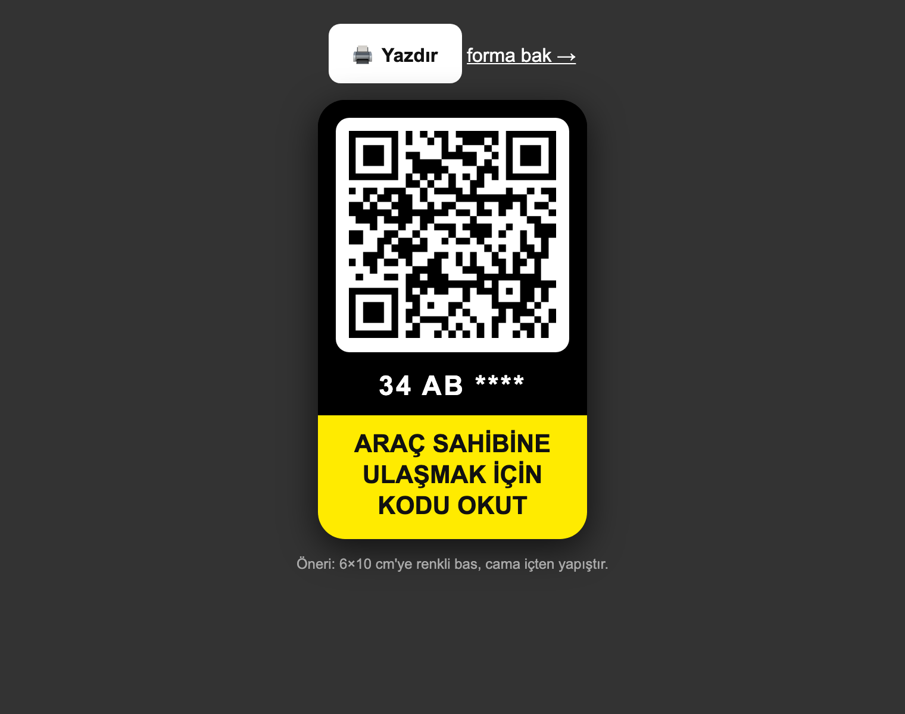
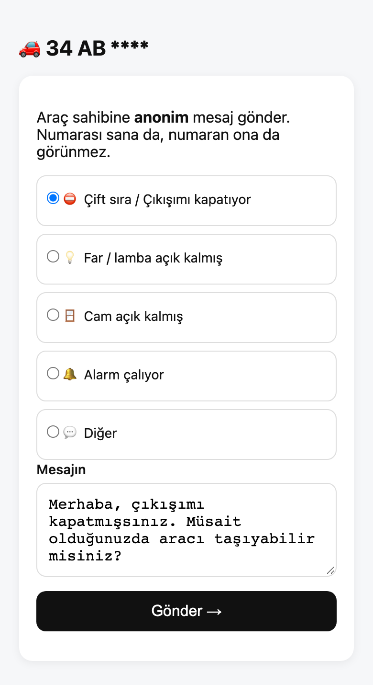
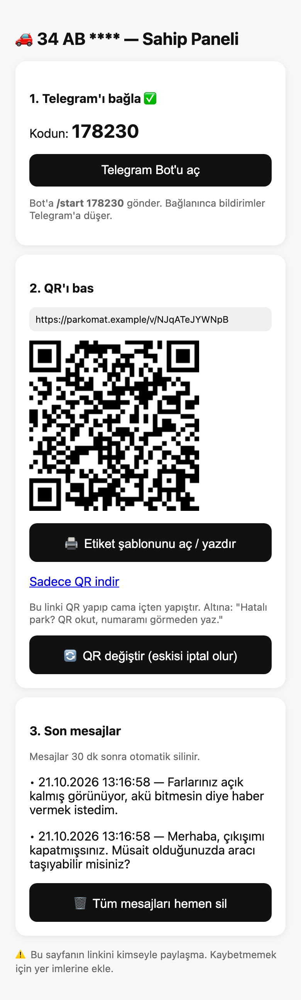

# 🚗 Parkomat

> A free QR parking sticker that lets anyone reach you on Telegram **without seeing your phone number**.

[](https://workers.cloudflare.com/)
[](https://developers.cloudflare.com/d1/)
[](https://core.telegram.org/bots/api)
[](LICENSE)
[](#free-tier)

<p align="center">
  <a href="https://www.buymeacoffee.com/cmtrkr"></a>
</p>

Parkomat is a free, open-source **QR parking sticker** for your car. Someone who scans the sticker can send you an anonymous message about bad parking, lights left on, an open window, or a car alarm — and the message arrives as a **Telegram direct message**. Your phone number is never printed, stored, or shared.

It runs entirely on the **Cloudflare Workers free tier**, with **D1** for storage and the **Telegram Bot API** for delivery. There is no app to install, no account, no ads, and no paid API.

**Live demo:** [create a sticker](https://parkomat.cmtrkr.workers.dev/sahip) · The interface is currently in Turkish; an English form is on the roadmap.

## 📸 Screenshots

<p align="center">
  <br>
  <sub>The printable 6×10 cm windshield sticker</sub>
</p>

| Anonymous message form | Owner panel |
| :---: | :---: |
| <br><sub>No phone number required</sub> | <br><sub>Telegram status, QR and recent messages</sub> |

## ✨ Features

- 🔒 **Number privacy.** The QR contains only a random token. Neither the car owner's nor the sender's phone number is exposed.
- 📲 **Telegram notifications.** Messages arrive instantly as a direct message to the owner's Telegram account.
- 🖨️ **Printable windshield sticker.** A black-and-yellow 6×10 cm template, ready for a home printer (`/v/:token/etiket`).
- 🗑️ **Automatic deletion.** Messages are removed from D1 after 30 minutes, using a cron trigger plus opportunistic cleanup.
- 🛡️ **Spam protection.** Per-IP rate limits (3 messages per 10 minutes, 10 per day), a per-vehicle hourly limit, and optional Cloudflare Turnstile.
- 🔄 **QR rotation.** Revoke an abused QR link with one click and issue a new one.
- 🆓 **Zero cost.** Designed to stay inside the Workers (100,000 requests/day) and D1 (5 GB) free limits.
- 📱 **No app required.** The sender only needs a phone camera and a browser.

## 🏗️ How it works

```text
[ QR on windshield ]  →  https://your-worker.workers.dev/v/A8f3K9xQ2m
                           │  masked plate + choose a reason + write a message
                           ▼  POST /api/v/:token/message
[ Cloudflare Worker ] → rate limit → [ save to D1 ] → [ Telegram Bot API ] → 📩 DM to you
```

1. The owner creates a vehicle record from `/sahip` and receives a public QR token, a private admin link, and a 6-digit Telegram link code.
2. The owner sends `/start <code>` to the bot. Parkomat stores the Telegram `chat_id` against the vehicle.
3. A passer-by scans the sticker, chooses a reason, writes a message, and submits it.
4. The Worker rate-limits the request, stores the message in D1, and sends a Telegram notification to the owner.
5. The message is deleted from D1 after the retention window. Delivered Telegram messages remain in the chat.

The phone number is **never** part of the flow. The link between the sticker and the owner is the Telegram `chat_id`, and the sticker only contains a random token.

## 🚀 Setup (5 minutes)

### 1. Prerequisites

- A Cloudflare account on the free plan
- Node.js 18+ and `wrangler`
- A Telegram bot created with [@BotFather](https://t.me/BotFather) (`BOT_TOKEN` + bot username)

### 2. Deploy the Worker

```bash
npm i -g wrangler
wrangler login

# Create the D1 database
wrangler d1 create parkomat-db
# → paste the resulting database_id into wrangler.toml

wrangler d1 execute parkomat-db --remote --file=migrations/0001_init.sql
wrangler d1 execute parkomat-db --remote --file=migrations/0002_channels.sql

# Secrets are prompted in the terminal; never commit or paste them into chat
wrangler secret put BOT_TOKEN
wrangler secret put PEPPER
wrangler secret put TELEGRAM_WEBHOOK_SECRET

wrangler deploy
# → https://parkomat.<account>.workers.dev
```

Set `BOT_USERNAME` in `wrangler.toml` to your bot's username (without `@`).

### 3. Connect the Telegram webhook

```bash
curl "https://api.telegram.org/bot<TOKEN>/setWebhook?url=https://<worker-address>/api/telegram/webhook?secret=<WEBHOOK_SECRET>"
# should return {"ok":true}
```

### 4. Create your first sticker

1. Open `https://<worker-address>/sahip` and enter the plate **masked** (`34 AB ****`).
2. Copy the 6-digit code from the owner panel and keep the private `/a/...` link safe.
3. Open `t.me/<bot>?start=<CODE>` and send `/start <CODE>`.
4. Print the 6×10 cm sticker and attach it to the inside of the windshield.

> Do not write the full plate. Mask the last digits with `****`. Never share the `/a/...` admin link; the `/v/...` QR link is the public one.

## 📁 Project structure

```text
parkomat/
├── src/worker.js              # Worker: API + pages + Telegram webhook
├── migrations/
│   ├── 0001_init.sql          # vehicles + messages tables
│   └── 0002_channels.sql      # notification channel columns
├── docs/screenshots/          # README preview images
└── wrangler.toml              # Worker + D1 + cron configuration
```

There are no runtime dependencies and no build step — the Worker is a single JavaScript file.

## 🔌 API

| Method | Endpoint | Description |
| --- | --- | --- |
| `GET` | `/` | Landing page |
| `GET` | `/sahip` | Vehicle creation page |
| `POST` | `/api/admin/create` | Creates a vehicle, public token, admin token, and Telegram link code |
| `GET` | `/a/:adminToken` | Private owner panel |
| `GET` | `/v/:publicToken` | Scanner-facing message form |
| `POST` | `/api/v/:publicToken/message` | Sends an anonymous message |
| `GET` | `/v/:publicToken/etiket` | Printable sticker template |
| `POST` | `/api/admin/rotate` | Rotates the public QR token |
| `POST` | `/api/admin/purge` | Deletes all messages for the vehicle |
| `GET` | `/api/admin/info` | Owner panel data |
| `POST` | `/api/telegram/webhook` | Telegram bot updates |

## 🔐 Privacy and security

- No phone numbers, names, or accounts are collected from the sender.
- The sender's IP is used only as a salted hash for rate limiting.
- The private admin link is the only credential for a vehicle. Keep it in your bookmarks and never share it.
- Never paste the bot token into chats, commits, or screenshots. If it leaks, revoke it with `@BotFather` → `/revoke`.
- Messages are deleted after `RETENTION_MINUTES` (default 30). Telegram notifications already delivered remain in Telegram.
- Turnstile is optional: set `TURNSTILE_SITE_KEY` and `TURNSTILE_SECRET_KEY` to enable it.
- This is a best-effort community tool. Do not use it as an emergency channel.

## 🗺️ Roadmap

- [ ] Turnstile bot protection (code ready, waiting for a site key)
- [ ] Photo notifications (R2)
- [ ] Two-way anonymous replies ("Thanks, on my way" button)
- [ ] Turkish/English UI switch
- [ ] Custom domain setup guide

## 🧪 Development

There is no build step. Run the Worker locally with Wrangler:

```bash
wrangler dev
# → http://localhost:8787
```

For local D1 migrations:

```bash
wrangler d1 execute parkomat-db --local --file=migrations/0001_init.sql
wrangler d1 execute parkomat-db --local --file=migrations/0002_channels.sql
```

## ❤️ Support

If Parkomat saves you a phone number or an awkward conversation, you can support the project:

[](https://www.buymeacoffee.com/cmtrkr)

Issues and pull requests are welcome.

## 📄 License

[MIT](LICENSE) © 2026 Cem Türker.

Parkomat is an independent project. It is not affiliated with or endorsed by Cloudflare or Telegram.
